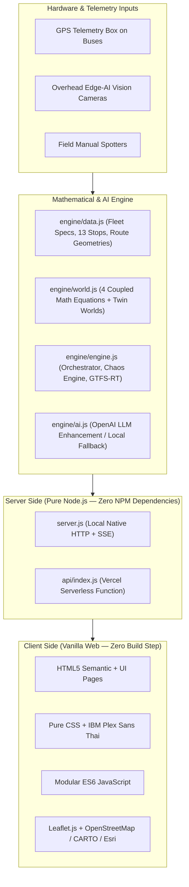

# เอกสารสรุปสถาปัตยกรรมระบบและโครงสร้างโค้ดฉบับสมบูรณ์ (OmniTransit v5)
> **สำหรับใช้งานเป็นพิมพ์เขียวบริบท (Context Blueprint) ในการเริ่มแชทใหม่หรือส่งมอบงานวิศวกรรม**  
> *โครงการวิจัยและพัฒนานวัตกรรมระบบขนส่งมวลชนอัจฉริยะ (AI for All: Public Transit Dynamic Crowding & Coupled ETA Prediction System)*

---

## 1. ลิงก์ระบบและแหล่งจัดเก็บโค้ด (Live URLs & Repositories)

- **เว็บไซต์ระบบที่ออนไลน์จริง (Vercel Production):**  
  👉 [https://ai-forall-eight.vercel.app](https://ai-forall-eight.vercel.app)
  - หน้าผู้โดยสารและแผนที่สด: `/index.html` หรือ `/`
  - หน้านายท่าศูนย์ควบคุมการปล่อยรถ: `/dispatcher.html`
  - หน้าสรุปผลการวิจัยและดัชนีชี้วัด (KPIs): `/kpi.html`
  - หน้าจำลองกล้อง AI มุมสูงเหนือประตู: `/spotter.html`
  - หน้าจออัจฉริยะประจำป้ายหยุดรถ (Smart Kiosk): `/kiosk.html`
  - หน้าทดสอบและจำลองเหตุขัดข้อง (Chaos Testing): `/sim.html`
  - หน้าทดสอบและประเมินผล AI Model: `/aieval.html`
  - หน้านโยบาย ธรรมาภิบาล และกรอบงบประมาณ: `/governance.html`
- **GitHub Repository (Public):**  
  👉 [https://github.com/Alicebbb111/AI-for-all](https://github.com/Alicebbb111/AI-for-all) (Branch: `main`)
- **ไดเรกทอรีโปรเจกต์ในเครื่อง Local:**  
  `/Users/bowornnan/work space/antigarvity/ai-forall`
- **รายงานสรุปเชิงเทคนิควิศวกรรม (PDF Report 4 หน้ามาตรฐาน A4):**  
  - โฟลเดอร์โปรเจกต์: `/Users/bowornnan/work space/antigarvity/ai-forall/OmniTransit_Prediction_System_Report.pdf`
  - โฟลเดอร์ Downloads: `/Users/bowornnan/Downloads/OmniTransit_Prediction_System_Report.pdf`

---

## 2. ปัญหาและวิสัยทัศน์ของโครงการ (Problem & Value Proposition)

### ปัญหาที่แท้จริงของรถเมล์ไทย:
1. **ไม่ใช่รถไม่พอ แต่เกิดจาก Bus Bunching (รถวิ่งไล่กวดกันจนติดเป็นขบวน):**  
   คันหน้าขาดระยะเพียงเล็กน้อย จะแบกรับคนสะสมที่ป้ายเกินกำลังจนแน่นเอี๊ยดและจอดแช่ป้ายนานขึ้นเรื่อยๆ ขณะที่คันหลังวิ่งตามมาติดๆ เป็นรถเปล่า
2. **ผู้โดยสารกลางทางถูกปล่อยทิ้ง (Pass-up):**  
   ผู้โดยสารตามป้ายระหว่างทาง (เช่น ประตูน้ำ, ราชเทวี, สามย่าน) ขึ้นรถไม่ได้เพราะรถเต็มเอี๊ยดจากป้ายต้นทาง
3. **เวลาถึง (ETA) ของแอปทั่วไปหลอกลวง:**  
   แอปแผนที่ทั่วไปคำนวณจาก `ระยะทาง ÷ ความเร็วถนน` โดยไม่คำนึงถึง "เวลาเปิดประตูจอดรับ-ส่งคน (Dwell Time)" ที่แปรผันตามจำนวนคนขึ้น-ลงจริง

### หลักการออกแบบระบบ (Guiding Principles):
- **Zero-Cost Stack:** ไม่เสียค่า API สักบาท ไม่ใช้ Google Maps API แบบเสียเงิน ไม่ใช้ไลบรารีภายนอกที่หนักหน่วง
- **Zero-Fake / Truthful AI:** หากสัญญาณ GPS ขาดเกิน 90 วินาที ระบบจะถอนเวลาสดออกทันทีและสลับไปใช้ตารางเวลามาตรฐาน ไม่หลอกลวงประชาชน
- **PDPA-by-Design (100% Legal):** ไม่สแกนใบหน้า (No Facial Recognition) ไม่ติดตาม GPS ส่วนตัวของผู้โดยสาร
- **Human-in-the-Loop & Labor Compliance:** ไม่ตัดสินใจตัดรอบรถโดยพลการ คุ้มครองเวลาพักคนขับ $\ge 6$ นาทีเสมอ

---

## 3. สถาปัตยกรรมทางเทคโนโลยี (Technology Stack)



| เลเยอร์ | เทคโนโลยีที่ใช้ | รายละเอียดและจุดเด่น |
| :--- | :--- | :--- |
| **Backend Core** | Pure Node.js (Built-in `http`, `fs`, `path`) | **Zero npm dependencies** ไม่ต้องรัน `npm install` รวดเร็ว เบา และเปิดรันได้ทันที |
| **Cloud Hosting** | Vercel Serverless Functions | รันผ่าน `api/index.js` พร้อมระบบจำลองเวลาเสมือน (Dynamic Simulation Tick) และ Client Polling Fallback |
| **Frontend UI** | HTML5, CSS3, Vanilla JS (ES6) | ไม่มี Framework (No React/Vue) โหลดไว ระดับเฟรมเรต 60fps ฟอนต์ IBM Plex Sans Thai ไร้ Emoji (ใช้ SVG ทั้งหมด) |
| **แผนที่ (Map)** | Leaflet 1.9.4 | เชื่อมต่อ 3 แหล่งฟรี ไม่ต้องใช้ API Key:<br>1. **CARTO Voyager / Dark Matter** (แผนที่ถนน ODbL)<br>2. **Esri World Imagery** (ภาพถ่ายดาวเทียมความละเอียดสูง)<br>3. **OSRM** (เส้นทางแนวถนนจริง 728 จุด) |
| **AI วิเคราะห์** | Hybrid Intelligence | 4 สมการคณิตศาสตร์ในเครื่อง 100% (Offline First) + OpenAI API (`gpt-4o-mini`/`gpt-4o`) เมื่อต้องการสังเคราะห์ข้อความสรุป |

---

## 4. ฮาร์ดแวร์ตรวจจับ: กล้อง AI มุมสูงเหนือประตู (Overhead Edge-AI Vision)

เดิมระบบสาธิตใช้ "เซ็นเซอร์ลำแสงอินฟราเรด (IR Beam)" แต่พบข้อจำกัดเมื่อมีคนก้าวขึ้นพร้อมกันหรือสะพายกระเป๋าใบใหญ่ จึงได้อัปเกรดเป็น **กล้อง AI มุมสูงเหนือประตู**:

### สเปกและการทำงาน:
1. **การติดตั้ง:** ติดตั้งกล้องมุมกดแนวดิ่ง $90^\circ$ เหนือช่องบันไดประตูขึ้น-ลงรถ
2. **โมเดลการประมวลผล:** ใช้อัลกอริทึม Top-Down Head-Shoulder Detection & Tracking (เช่น YOLOv8-Nano ร่วมกับ ByteTrack) รันบนชิป Edge NPU ภายในกล่องประมวลผลบนตัวรถ
3. **การนับข้ามเส้นสมมติ (Virtual Tripwire Line Crossing):**
   - ผู้โดยสารก้าวข้ามเส้นด้านใน $\to$ นับเป็นคนขึ้น ($B^{\text{cam}}_j$)
   - ผู้โดยสารก้าวข้ามเส้นด้านนอก $\to$ นับเป็นคนลง ($A^{\text{cam}}_j$)
4. **ความสอดคล้องกับ PDPA 100% (Privacy-by-Design):**
   - กล้องมองเห็นเฉพาะกระหม่อม ศีรษะ และไหล่ **ไม่เห็นใบหน้าของผู้โดยสาร**
   - ประมวลผลเสร็จในหน่วยความจำชั่วคราวแล้วลบภาพทิ้งทันที (Zero Video Storage)
   - ส่งออกเฉพาะข้อมูลตัวเลขสรุป ($B^{\text{cam}}, A^{\text{cam}}$) ผ่านคลื่นเซลลูลาร์เข้าสู่เซิร์ฟเวอร์

---

## 5. เครื่องจักรคำนวณ: 4 สมการหลักทางคณิตศาสตร์และวิศวกรรมขนส่ง

ระบบไม่ได้ใช้การเดา แต่เชื่อมโยงสมการเป็นลูกโซ่ต่อเนื่อง (Coupled Mathematical Architecture):

```
[ข้อมูลกล้อง AI ประตู] + [ระยะห่างคันหน้า H_j] 
        ↓
(สมการที่ 1: ไหลสะสมรายป้าย k → m) 
        ↓
(สมการที่ 2: Coupled Dynamic ETA รวมเวลาจอดตามจำนวนคน)
        ↓
(สมการที่ 3: สอบทานกล้อง AI กับเวลาเปิดประตูจริง Bayesian Cross-Check)
        ↓
(สมการที่ 4: คุมช่องไฟสองทิศทาง Daganzo Holding สำหรับนายท่า)
```

### 5.1 สมการที่ 1: การไหลสะสมรายป้ายและคำนวณคนถูกปล่อยทิ้ง (Stop-by-Stop Load Propagation)
เมื่อรถอยู่ที่ป้าย $k$ และผู้โดยสารรออยู่ที่ป้าย $m$ ระบบจะจำลองล่วงหน้าทีละป้าย $j = k+1 \to m$:
1. **คนที่จะลงที่ป้าย $j$:**  
   $$\hat{A}_j = \text{round}\Big(\hat{N}_{j-1} \cdot \rho_j(t)\Big)$$
   *(โดย $\rho_j(t)$ คือความน่าจะเป็นที่คนจะลงป้ายนั้น เช่น อนุสาวรีย์ชัยฯ 28%, สยาม 32%)*
2. **คนมารอขึ้นที่ป้าย $j$:**  
   $$\hat{D}_j = \Big(\lambda_j(t) \cdot \omega_{\text{rain}} \cdot H_j\Big) + Q_j^{\text{leftover}}$$
   *(ผูกตรงกับช่องไฟ $H_j$: ถ้ารถคันหน้าทิ้งห่างนาน คนสะสมจะยิ่งมาก + คิวตกค้างสะสม $Q$)*
3. **คนที่ขึ้นได้จริง (ติดเพดานความจุตัวรถ):**  
   $$\hat{B}_j = \min\Big(\hat{D}_j, \; C_{\max} - (\hat{N}_{j-1} - \hat{A}_j)\Big)$$
4. **คนบนรถเมื่อออกจากป้าย $j$:**  
   $$\hat{N}_j = \hat{N}_{j-1} - \hat{A}_j + \hat{B}_j$$
5. **คนที่ขึ้นไม่ได้ (Pass-up Rate):**  
   $$\text{PassUp}_j = \max(0, \; \hat{D}_j - \hat{B}_j)$$

---

### 5.2 สมการที่ 2: เวลาถึงที่ผูกกับจำนวนคนขึ้น-ลง (Coupled Dynamic ETA)
$$\widehat{\text{ETA}}_{k \to m} = \sum_{s=k}^{m-1} \frac{L_s}{v_s^{\text{EMA}}} + \sum_{j=k+1}^{m-1} \tau_{\text{dwell}}(j) + \sum_{r} d_r^{\text{signal}}$$
โดยเวลาจอดเปิดประตูแต่ละป้ายแปรผันตามจำนวนคนจริง:
$$\tau_{\text{dwell}}(j) = \Big(\tau_0 + \alpha \hat{B}_j + \beta \hat{A}_j\Big) \cdot \gamma_{\text{crowd}}$$
- $\tau_0 = 9$ วินาที (เวลาเทียบป้ายและเปิด-ปิดประตู)
- $\alpha = 2.2$ วิ/คน (รถเก็บเงินสด) หรือ $1.6$ วิ/คน (รถ EV ประตูกว้าง)
- $\beta = 1.4$ วิ/คน (เวลาคนก้าวลง)
- $\gamma_{\text{crowd}} = 1.35$ เมื่อคนบนรถเกิน 75% ของความจุ (ตัวคูณโทษความแออัด คนต้องเบียดตัวลงช้าลง 35%)

---

### 5.3 สมการที่ 3: สอบทานกล้อง AI กับเวลาเปิดประตูจริง (Bayesian Vision-Dwell Cross-Check)
แม้กล้อง AI จะแม่นยำสูง (97%+) แต่ในสภาวะมืดจัดหรือฝนตกหนักอาจมี Noise ระบบจึงนำเวลาเปิดประตูจริง ($\tau_{\text{actual}}$) มาถ่วงน้ำหนักตรวจสอบทาน:
1. **ยอดคนขึ้นโดยนัยจากเวลาเปิดประตู:**  
   $$\hat{B}^{\text{implied}}_j = \max\left(0, \; \frac{\tau_{\text{actual}} - \tau_0}{\alpha}\right)$$
2. **ยอดที่ปรับแก้ถ่วงน้ำหนักแล้ว:**  
   $$\hat{B}^{\text{corrected}}_j = \text{round}\Big(0.85 \cdot B^{\text{cam}}_j + 0.15 \cdot \hat{B}^{\text{implied}}_j\Big)$$
3. **ความไม่แน่นอนสะสมเมื่อมองข้ามป้าย ($\pm \sigma$):**  
   $$\sigma_m = \sqrt{\sigma_k^2 + (\text{จำนวนป้ายที่มองข้าม}) \cdot (1.1)^2}$$
   *(แสดงผลต่อประชาชนอย่างซื่อสัตย์ เช่น "ประมาณ 32 ± 2 คน" และรีเซ็ต $\sigma = 0$ เมื่อถึงอู่ปลายทาง)*

---

### 5.4 สมการที่ 4: การควบคุมช่องไฟสองทิศทางของนายท่า (Two-Sided Headway Regularization)
เพื่อหยุดยั้ง Bus Bunching อย่างยั่งยืน ระบบคำนวณเวลาหน่วงปล่อยรถที่ต้นทาง ($\Delta t_{\text{hold}}$) ตามหลักการ Daganzo:
$$\Delta t_{\text{hold}} = \text{clamp}\Bigg( 0.5 \cdot (H_{\text{target}} - H_{\text{front}}) + 0.25 \cdot (H_{\text{back}} - H_{\text{front}}), \;\; 0, \;\; 5 \text{ นาที} \Bigg)$$
- **เงื่อนไขคุ้มครองแรงงาน:** พนักงานขับรถต้องได้พักสะสมที่อู่ $T_{\text{rest}} \ge 6$ นาทีเสมอ และห้ามตัดจำนวนเที่ยววิ่งขั้นต่ำ

---

## 6. โครงสร้างไฟล์และหน้าที่ในโปรเจกต์ (Code Anatomy)

```
ai-forall/
├── api/
│   └── index.js             # Vercel Serverless Function (แปลง HTTP Engine เป็น Serverless)
├── engine/
│   ├── ai.js                # จัดการ OpenAI API (GPT-4o/mini) + Prompt Guardrails
│   ├── data.js              # ฐานข้อมูล 13 ป้ายจริง, 3 รุ่นรถ ขสมก., สปีดเฉลี่ย, เมทริกซ์ OD
│   ├── engine.js            # Engine ตัวคุมกลาง, Seeded Demand, Twin Worlds, GTFS-RT
│   ├── route_geo.js         # พิกัดแนวถนนจริงความละเอียดสูง 728 จุด (WGS84 จาก OSRM)
│   └── world.js             # คณิตศาสตร์ 4 สมการ, จำลองฟิสิกส์การวิ่ง, Daganzo, Bayesian
├── public/
│   ├── css/app.css          # สไตล์มินิมอล, Dark/Light theme, ตัวนับความแน่น, Flow Visualizer
│   ├── js/
│   │   ├── common.js        # SSE + Smart Polling Fallback, Topbar, Modal, Theme Manager
│   │   ├── passenger.js     # Leaflet Map, Live Bus Markers, Drawer รถ, ค้นหาเส้นทาง
│   │   ├── dispatcher.js    # หน้านายท่า, การอนุมัติหน่วงปล่อยรถ, แจ้งเตือน Bunching
│   │   ├── spotter.js       # หน้าจำลองกล้อง AI มุมสูง (Virtual Tripwire) & ผู้สำรวจ
│   │   ├── kpi.js           # คำนวณตารางเปรียบเทียบ Baseline vs OmniTransit (ลด Pass-up ≥15%)
│   │   ├── kiosk.js         # ป้ายประกาศสถานีตัวอักษรใหญ่ คมชัด เข้าถึงง่าย
│   │   └── sim.js           # Chaos Injection: สั่งฝนตก, ชั่วโมงเร่งด่วน, กล้องเสีย, GPS ดับ
│   ├── index.html           # หน้าหลักประชาชนผู้โดยสาร
│   ├── dispatcher.html      # หน้าศูนย์ควบคุมนายท่า
│   ├── kpi.html             # แดชบอร์ดสรุปผลการวิจัยและตัวชี้วัด
│   ├── spotter.html         # จำลองมุมกล้อง AI และผู้สำรวจ
│   ├── kiosk.html           # ป้ายรถเมล์อัจฉริยะ
│   ├── sim.html             # แผงควบคุมการทดสอบ
│   └── aieval.html          # หน้าประเมินความแม่นของ AI (Confusion Matrix)
├── scripts/
│   ├── build_route.js       # สคริปต์ยิง OSRM ดึง 728 พิกัดถนนจริงใน กทม.
│   └── generate_pdf_report.py # สคริปต์คอมไพล์ PDF รายงานวิชาการ 4 หน้าผ่าน Headless Chrome
├── server.js                # Native Node.js HTTP/SSE Server สำหรับ Local รันพอร์ต 8787
├── package.json             # กำหนด Node >= 18 (Zero Dependency)
├── OmniTransit_Prediction_System_Report.pdf # ไฟล์รายงาน PDF 4 หน้าฉบับสมบูรณ์
└── README.md                # คู่มือการใช้งานเบื้องต้น
```

---

## 7. ประเด็นตอบคำถามทางวิศวกรรมที่สำคัญ (Key Defense & Q&A)

### Q1: ติดกล้อง AI ที่ประตูแล้ว รู้จำนวนคนแล้ว ทำไมยังต้องทำระบบพยากรณ์?
> **คำตอบ:** กล้อง AI บอกได้แค่ว่า **"วินาทีนี้บนรถมีกี่คน (อดีต/ปัจจุบัน)"** แต่ผู้โดยสารที่ยืนรออยู่ป้ายถัดไปต้องการรู้ว่า **"อีก 15 นาทีข้างหน้า เมื่อรถวิ่งมาถึงป้ายของเขา รถจะแน่นหรือว่าง (อนาคต)"**  
> กล้องเพียงอย่างเดียวไม่สามารถรู้ได้ว่าระหว่างทางคนจะแย่งกันขึ้นที่อนุสาวรีย์ชัยฯ กี่คน หรือจะลงที่สยามกี่คน ระบบสมการไหลสะสม (สมการที่ 1) และ Coupled ETA (สมการที่ 2) จึงทำหน้าที่เป็น **"สมอง"** ที่เปลี่ยนข้อมูลจากกล้อง (ซึ่งเป็นแค่ **"ดวงตา"**) ให้กลายเป็นการคาดการณ์ล่วงหน้าข้ามหลายป้ายได้

### Q2: ทำไมไม่ใช้ ChatGPT / Deep Learning มาสั่งปล่อยรถของนายท่า?
> **คำตอบ:** การควบคุมการเดินรถสาธารณะเป็นเรื่องความปลอดภัยและชีวิตคน จึงต้องเป็น **Explainable AI** ที่ตรวจสอบที่มาของตัวเลขได้ 100% สมการ Daganzo (สมการที่ 4) ให้เหตุผลชัดเจนว่าทำไมต้องหน่วง 2 นาที (เพราะคันหน้าห่างเกินรอบไปเท่าใด) และมี **Safety Guardrail** ล็อกเวลาพักคนขับ $\ge 6$ นาทีตามกฎหมายแรงงาน ซึ่งการใช้ LLM แบบ Black-box อาจตัดสินใจผิดพลาดหรือละเมิดกฎหมายแรงงานได้

---

## 8. Prompt สำหรับนำไปวางในแชทใหม่เพื่อสั่งงานต่อได้ทันที

หากต้องการนำโปรเจกต์นี้ไปคุยต่อกับ AI ตัวใหม่ (Claude Code, ChatGPT หรืออื่นๆ) ให้ก็อปปี้ข้อความด้านล่างนี้ไปวางเป็นข้อความแรกได้เลยครับ:

```markdown
สวัสดีครับ ฉันกำลังพัฒนาโปรเจกต์ชื่อ "OmniTransit v5" ซึ่งเป็นระบบคาดการณ์ความหนาแน่นและเวลาถึงรถโดยสารสาธารณะอัจฉริยะ (Public Transit Dynamic Crowding & Coupled ETA Prediction System) เพื่อแก้ปัญหารถขาดระยะและการกระจุกตัวของผู้โดยสาร (Bus Bunching & Pass-Up) ในกรุงเทพมหานคร

โปรเจกต์นี้ตั้งอยู่ที่ไดเรกทอรี: `/Users/bowornnan/work space/antigarvity/ai-forall`
GitHub Repository: https://github.com/Alicebbb111/AI-for-all
เว็บที่ Deploy ใช้งานจริงบน Vercel: https://ai-forall-eight.vercel.app

ข้อมูลสถาปัตยกรรมหลักของระบบในปัจจุบัน:
1. Tech Stack:
   - Backend: Pure Node.js (Zero npm dependencies) รันบน server.js (Local port 8787) และ api/index.js (Vercel Serverless Function)
   - Frontend: Vanilla HTML5 / CSS3 / ES6 JS โดยไม่มี Framework หน้าตาโมเดิร์น ใช้ฟอนต์ IBM Plex Sans Thai และห้ามมี Emoji ในโค้ด/UI (ใช้เฉพาะ SVG สะอาดตา)
   - แผนที่: Leaflet.js ดึงไทล์ฟรีจาก CARTO Voyager (กลางวัน), CARTO Dark Matter (กลางคืน), Esri World Imagery (ดาวเทียม) และเส้นทางถนนจริง 728 จุด WGS84 จาก OSRM (สายนำร่อง 1: อู่บางเขน - จตุจักร - สยาม - หัวลำโพง รวม 13 ป้ายจริง)
2. ฮาร์ดแวร์ตรวจจับผู้โดยสาร:
   - ใช้ "กล้อง AI มุมสูงแนวดิ่ง 90° เหนือประตูรถ (Overhead Edge-AI Vision Counter)" ตรวจจับศีรษะ-ไหล่ข้ามเส้น Virtual Tripwire (In=ขึ้น B_cam, Out=ลง A_cam) บน Edge NPU 
   - ปลอดภัยตาม PDPA 100% เพราะไม่เห็นใบหน้า ไม่สตรีมภาพ และส่งเฉพาะตัวเลขจำนวนคน
3. สถาปัตยกรรมเครื่องจักรคำนวณ 4 สมการหลัก:
   - สมการที่ 1: Stop-by-Stop Load Propagation (คำนวณไหลสะสมข้ามป้าย k -> m และคำนวณคนถูกปล่อยทิ้ง Pass-up)
   - สมการที่ 2: Coupled Dynamic ETA (เวลาถึงผูกกับเวลาเปิดประตูจอด Dwell Time ซึ่งคิดตามจำนวนคนขึ้น-ลงจริง และตัวคูณโทษความแออัด 1.35x เมื่อคนเกิน 75%)
   - สมการที่ 3: Bayesian Vision-Dwell Cross-Check (สอบทานยอดกล้อง AI กับเวลาเปิดประตูจริง 0.85*B_cam + 0.15*B_implied พร้อมความไม่แน่นอนสะสม ±σ)
   - สมการที่ 4: Daganzo Two-Sided Headway Regularization (นายท่าคำนวณเวลาหน่วงปล่อยรถเพื่อคุมช่องไฟคันหน้า-คันหลัง โดยล็อกเวลาพักคนขับ >= 6 นาที)
4. สถานะปัจจุบัน:
   - ซอร์สโค้ดผ่านการทดสอบไวยากรณ์ 100% ไม่มี Error
   - เว็บบน Vercel ออนไลน์พร้อมใช้งาน
   - มีเอกสารรายงาน PDF 4 หน้า A4 ฉบับสมบูรณ์อยู่ที่ `/Users/bowornnan/work space/antigarvity/ai-forall/OmniTransit_Prediction_System_Report.pdf`

กรุณาศึกษาบริบทนี้เพื่อช่วยฉันพัฒนาและต่อยอดระบบในขั้นตอนต่อไป
```
